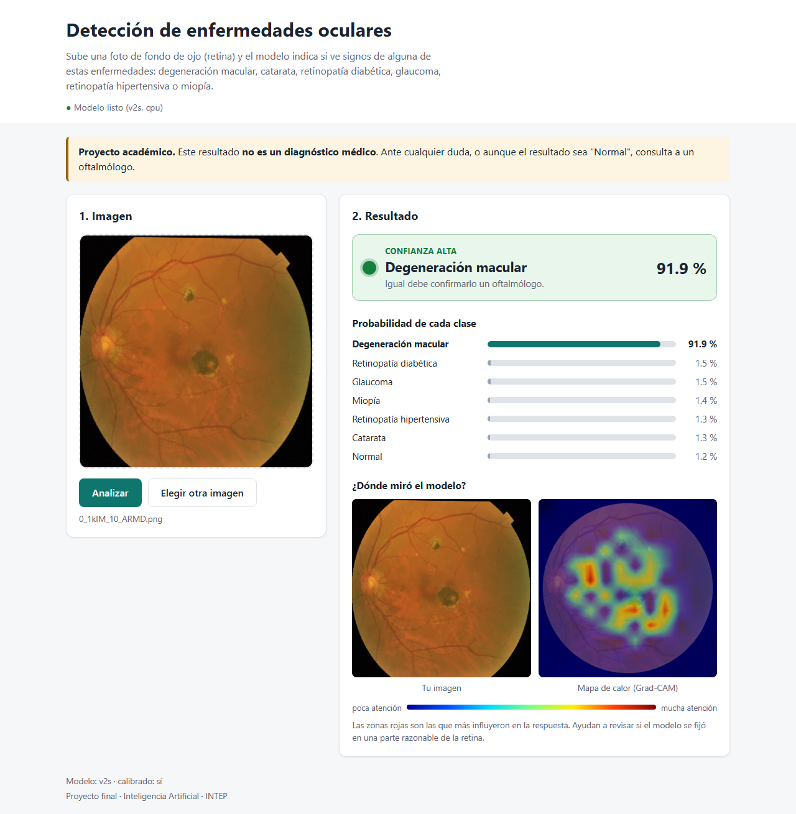

# Detección de enfermedades oculares con IA

Aplicación web que analiza una **foto de fondo de ojo (retinografía)** e indica si ve signos de alguna de estas enfermedades:

| Código | Enfermedad |
|---|---|
| A | Degeneración macular asociada a la edad |
| C | Catarata |
| D | Retinopatía diabética |
| G | Glaucoma |
| H | Retinopatía hipertensiva |
| M | Miopía patológica |
| N | Normal |

Muestra la enfermedad más probable, un **semáforo de confianza** calibrado, la probabilidad de cada clase y un **mapa de calor (Grad-CAM)** con las zonas de la retina que más influyeron en la respuesta.

> ⚠️ **Aviso importante:** proyecto académico (Inteligencia Artificial, INTEP). **No es un dispositivo médico ni reemplaza el diagnóstico de un oftalmólogo.** No debe usarse para tomar decisiones clínicas. Ante cualquier síntoma o duda, consulte a un profesional de la salud, aunque el resultado sea "Normal".



## Resultados

Modelo final: **EfficientNetV2-S** (preentrenado en ImageNet, *fine-tuning* completo, entrada de 384 px). Medido **una sola vez** en el conjunto de test (1 446 imágenes que el modelo nunca vio, separadas por paciente):

| Métrica | Valor |
|---|---|
| Exactitud (*accuracy*) | 86,4 % |
| F1 macro | 0,886 |
| Sensibilidad (enfermos detectados como enfermos) | 90,0 % |
| Especificidad (sanos reconocidos como sanos) | 89,3 % |

| Clase | A | C | D | G | H | M | N |
|---|---|---|---|---|---|---|---|
| F1 | 0,99 | 1,00 | 0,85 | 0,84 | 0,82 | 0,87 | 0,83 |

**Semáforo de confianza** (probabilidades calibradas con *temperature scaling*, ECE 0,11 → 0,04):

| Nivel | Regla | En test |
|---|---|---|
| 🟢 Alta | confianza ≥ 88 % | 51 % de las imágenes, **acierta el 98,2 %** |
| 🟡 Media | 80 – 88 % | confirmar con un especialista |
| 🟡 Normal | el modelo no ve enfermedad | **nunca se muestra en verde**: se recomienda control anual |
| 🔴 Baja | confianza < 80 % | resultado incierto, consultar a un especialista |

**Política de tamizaje:** en una prueba de detección temprana, dejar pasar a un enfermo es peor que una falsa alarma. Por eso el modelo exige más evidencia antes de responder "Normal". Así, ningún enfermo del test recibió "Normal" con confianza alta, a cambio de algunas falsas alarmas más.

### Limitaciones conocidas

- **Atajo de origen (ODIR):** la mayoría de los errores "enfermo → Normal" son imágenes del dataset ODIR, donde las etiquetas vienen del paciente y no siempre del ojo fotografiado. Para corregirlo hacen falta más imágenes normales de otras fuentes.
- **Catarata = imagen sin detalle:** el modelo aprendió que una imagen borrosa o blanca indica catarata. Una foto desenfocada de un ojo sano puede salir "Catarata". La app lo advierte.
- **Retinopatía diabética leve** y una retina normal se parecen mucho a la resolución usada. D y N son las clases con más confusión.
- El filtro de calidad se ajustó con las imágenes de este dataset. Con otras cámaras puede rechazar o aceptar imágenes de forma distinta.
- El dataset mezcla varias fuentes públicas, y las métricas pueden no generalizar a otras poblaciones o equipos.

## Cómo funciona

```
foto → recorte de la retina → filtro de calidad → EfficientNetV2-S → calibración → política de tamizaje → JSON
       (preprocessing.py)     (quality.py)        (model.py)         (calibrate.py)                       (api/main.py)
                                                       └→ Grad-CAM (gradcam.py) ──────────────────────────┘
```

1. **Preprocesamiento:** recorta el fondo negro, centra la retina, la lleva a 512 px y aplica una máscara circular.
2. **Filtro de calidad:** rechaza imágenes oscuras, planas o que no parecen una retina. Las borrosas o muy claras pasan con advertencia, porque una catarata real también se ve así.
3. **Modelo:** EfficientNetV2-S con transfer learning en dos etapas (primero solo la cabeza nueva, luego toda la red). Se entrenó con pesos por clase, *label smoothing*, *data augmentation*, AMP y *early stopping* según el F1 macro de validación.
4. **Calibración:** *temperature scaling*, ajustado en validación.
5. **Explicabilidad:** Grad-CAM sobre la última capa convolucional.

**Datos:** dataset público de Kaggle ("Eye Diseases Classification"), basado en ODIR-5K y otras fuentes. Son 10 449 imágenes en 7 clases, divididas 71/14/14 % (train/val/test) **por paciente** (`StratifiedGroupKFold`), con detección de imágenes casi duplicadas para que no haya fugas entre conjuntos.

## Instalación

Requisitos: Python 3.11+ y [uv](https://docs.astral.sh/uv/).

```bash
git clone https://github.com/JuanMillan7818/eye-disease-detection.git
cd eye-disease-detection
uv sync
```

**El modelo entrenado no está en el repositorio** (82 MB). Descarga `v2s_best.pth` desde la sección *Releases* del repositorio y guárdalo en `models/`.

Para verificar el archivo (PowerShell):

```powershell
Get-FileHash models\v2s_best.pth -Algorithm SHA256
# 192F0D380F6099FE78217B27FE44D3FE7804F79EE0A90508D04D33A3E6C0C088
```

## Uso

### Aplicación web

```bash
uv run uvicorn api.main:app
```

Abre <http://127.0.0.1:8000>, arrastra una foto de fondo de ojo y pulsa **Analizar**.

### API REST

La documentación interactiva está en <http://127.0.0.1:8000/docs>.

```bash
curl -F "file=@foto.jpg" http://127.0.0.1:8000/predict
```

| Endpoint | Descripción |
|---|---|
| `GET /health` | Estado del modelo, dispositivo y clases |
| `POST /predict` | Recibe una imagen (`file`, JPG o PNG, ≤ 10 MB). `?heatmap=false` omite el mapa de calor |

Códigos de respuesta: `200` resultado · `400` no es una imagen · `413` más de 10 MB · `422` la imagen no sirve para el análisis (`detail.issues` explica el motivo).

Variables de entorno opcionales: `MODEL_NAME` (por defecto `v2s`), `MODELS_DIR` (por defecto `models`), `ALLOWED_ORIGINS` (CORS).

### Línea de comandos

```bash
uv run python -m src.predict ruta/a/foto.jpg
uv run python -m src.gradcam ruta/a/foto.jpg      # guarda el mapa de calor en reports/figures/gradcam/
```

### Sin PyTorch (ONNX)

El modelo también está exportado a **ONNX**, un formato estándar que se puede usar desde Python, C#, Java o JavaScript con [ONNX Runtime](https://onnxruntime.ai/). Se distribuye en dos archivos:

- `v2s.onnx`: la red con la calibración incluida.
- `v2s.onnx.json`: las clases, el preprocesamiento y la política del semáforo.

```bash
pip install onnxruntime numpy pillow
python examples/onnx_predict.py v2s.onnx foto.jpg
```

[examples/onnx_predict.py](examples/onnx_predict.py) no depende del resto del proyecto. Se verificó que da la misma respuesta que la API en 145 de 145 imágenes de test. Tiene una diferencia: **no incluye el filtro de calidad**.

Para generar los archivos ONNX desde el checkpoint:

```bash
uv run --group export python -m src.export_onnx
```

## Reproducir el entrenamiento

```bash
uv run python -m src.explorer          # 1. exploración de los datos
uv run python -m src.prepare_data      # 2. preprocesamiento y división por paciente
uv run python -m src.train --model v2s # 3. entrenamiento (mejor en GPU: notebooks/02_training_colab.ipynb)
uv run python -m src.evaluate --split val --models v2s
uv run python -m src.calibrate --model v2s
```

El entrenamiento se hizo en Google Colab (GPU L4, ~1,5 h). El dataset va en `data/<clase>/`.

## Tests

```bash
uv run pytest -q
```

Se prueban la API (predicción, rechazo de imágenes inválidas, límites de tamaño) y que la página web se sirva. Los tests que necesitan el modelo se saltan si `models/` no existe.

## Estructura

```
api/main.py            API REST (FastAPI) que además sirve la web
web/                   frontend: index.html, styles.css, app.js
src/
  explorer.py          exploración del dataset
  preprocessing.py     recorte y máscara de la retina
  prepare_data.py      división por paciente y preprocesamiento
  dataset.py           Dataset, transformaciones y pesos por clase
  model.py             EfficientNet-B0 / V2-S con transfer learning
  train.py             entrenamiento en dos etapas
  evaluate.py          métricas, matriz de confusión, TTA
  calibrate.py         temperature scaling y política de tamizaje
  predict.py           predicción por consola
  gradcam.py           mapas de calor Grad-CAM
  quality.py           filtro de calidad de imagen
  source_report.py     aciertos por origen de la imagen
  export_onnx.py       exportación a ONNX
examples/onnx_predict.py  uso del modelo sin PyTorch
notebooks/             exploración y entrenamiento en Colab
reports/               métricas, predicciones y figuras
tests/                 tests de la API
```

## Tecnologías

PyTorch · torchvision · scikit-learn · FastAPI · ONNX Runtime · Grad-CAM · HTML/CSS/JavaScript · uv · Google Colab
